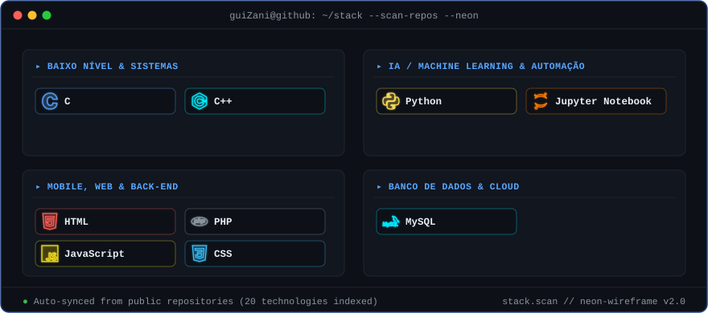

  <!-- 1º: Heatmap ocupando a linha inteira -->
  
  
    

  <!-- 2º: Par lado a lado (ASCII na esquerda + Info-Card na direita, sem bordas externas) -->
  

    
    &nbsp;
    
  

   

  <!-- 3º: Stack separada por categorias com logos em Neon Vazado -->
  

    
  Inspired by the project by <a href="https://github.com/AVIVASHISHTA29">AVIVASHISHTA29</a>

