  <h3><code>guilherme@github ~ $ ./contributions.sh</code></h3>
  
    
  <h3><code>guilherme@github ~ $ whoami</code></h3>
  <table>
    <tr>
      <td valign="top"></td>
      <td valign="top"></td>
    </tr>
  </table>
  
   
  Inspired by the project by <a href="https://github.com/AVIVASHISHTA29">AVIVASHISHTA29</a>

